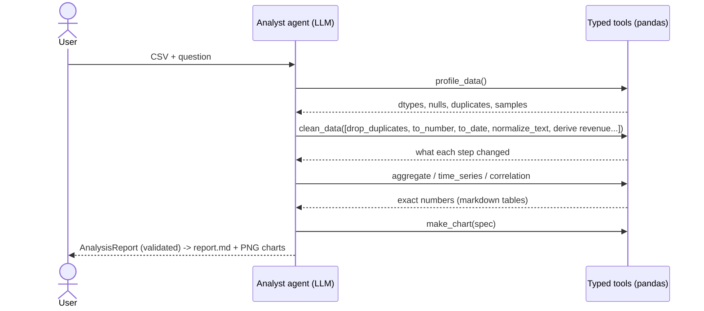

# autonomous-data-analyst

> Give it a messy CSV and a business question. A **PydanticAI** agent profiles the data, cleans it, runs the analysis, draws the charts and writes the report — with zero human input, and **without ever executing LLM-written code**.


**Demo video (2 min):** _add link_

```bash
$ analyst data/sample_sales.csv "Which region drives our revenue, and how did revenue evolve during 2026?"

North America leads with $43,029 in revenue, essentially tied with Latam ($42,687, -0.8%);
Europe trails at $36,756. Revenue peaked in July ($17,206) after a sharp dip in June ($9,399).

Report: output/report.md  |  charts: revenue_by_region.png, revenue_by_month.png  |  tool calls: 7
```

👉 See the full generated report: [`docs/example/report.md`](docs/example/report.md)

<p align="center"></p>

## How it works



## Why it's built this way

| Decision | Why it matters |
|---|---|
| **No code interpreter.** The LLM composes typed operations (`CleanOp`, `Metric`, `ChartSpec`) instead of writing Python. | Zero arbitrary-code-execution risk, no sandbox to maintain, and every step is logged and reproducible. |
| **Numbers come from pandas, never from the model.** The instructions forbid estimating; every finding cites the tool output it came from (`evidence`). | Kills the most dangerous failure in analytics agents: plausible, invented numbers. |
| **Typed result** (`AnalysisReport` Pydantic model) | The report always has an answer, findings, data-quality notes and a confidence level — or the run fails loudly. |
| **Output validator guardrail** | If the model cites a chart it never created, the answer is rejected and the model must fix it. |
| **Tool errors become retries** (`ModelRetry`) | A wrong column name returns "Unknown column 'country'. Available: [...]" to the model, which corrects itself. |
| **Budgets** | Max 25 tool calls, 30 model requests and 300k tokens per analysis. Tables sent to the model are capped at 25 rows. |
| **Flat schema for the model, strict types inside** | A 7-way discriminated union (`oneOf`) confused free models: they sent strings instead of objects and Groq rejected the call. The model now sees one flat `CleanStep` object; the code converts it to strict typed operations and any mistake goes back as a fixable error (tested in `test_clean_schema.py`). |

## Evaluation

`evals/run_evals.py` scores the agent on questions whose correct answer is known:

1. **Correctness (deterministic):** a reference solution in plain pandas computes the right answer; the agent must name it and quote the number within 1%.
2. **Faithfulness (LLM-as-a-judge):** a separate judge model reads the raw tool outputs the agent saw and flags any claim not supported by them.
3. **Cost:** tool calls and tokens per case are reported.

```bash
python evals/run_evals.py
{"id": "top_region", "correct_label": true, "correct_number": true, "faithful": true, "tool_calls": 5, ...}
Score: 100% (3 cases)
```

Add a case = add a question + reference spec to `evals/cases.json`.

## Choose your LLM: Claude or a free tier

Anthropic Claude is the default. Groq and OpenRouter (both with free tiers) are one variable away — the agent logic doesn't change, only the model object does.

| Provider | `LLM_PROVIDER` | Default model | Key variable |
|---|---|---|---|
| Anthropic | `anthropic` (default) | `claude-sonnet-5-5` | `ANTHROPIC_API_KEY` |
| Groq | `groq` | `openai/gpt-oss-120b` | `GROQ_API_KEY` ([get one](https://console.groq.com/keys)) |
| OpenRouter | `openrouter` | `openrouter/free` (routes to a free model with the features the request needs) | `OPENROUTER_API_KEY` ([get one](https://openrouter.ai/keys)) |

```bash
analyst data/sample_sales.csv "Which region sells most?" --provider groq
analyst data/sample_sales.csv "Which region sells most?" --provider openrouter
```

Override the model with `LLM_MODEL` (or `--model`). Free tiers have rate limits and smaller models follow schemas less reliably than Claude — the validation-and-retry loops in this project exist exactly for that.

## Quickstart

```bash
git clone https://github.com/<your-user>/autonomous-data-analyst && cd autonomous-data-analyst
python -m venv .venv && source .venv/bin/activate
pip install -e ".[dev]"
cp .env.example .env    # pick LLM_PROVIDER, add its key and export them

analyst data/sample_sales.csv "Which product sold the most units, and in which channel?"

# watch the agent loop live: every THINK / ACT / OBSERVE step
analyst data/sample_sales.csv "Which region sells most?" --trace
```

The CLI reads `.env` automatically. Every run is saved to `traces/run-*.json` (steps, tool results, tokens and the full conversation with the model); use `--no-save` to skip it. Under the hood `--trace` uses PydanticAI's `agent.iter()` to walk the same loop that `run_sync()` hides — see [`trace.py`](src/data_analyst/trace.py).

`data/sample_sales.csv` is intentionally messy (duplicates, `$` in prices, mixed date formats, inconsistent region names, missing values) — regenerate it with `python data/make_sample.py`.

Tests run offline using PydanticAI's `FunctionModel` to script the LLM while the **real tools** run:

```bash
pytest -q
```

## Project structure

```
src/data_analyst/
  agent.py        # PydanticAI agent: tools, guardrails, typed AnalysisReport
  operations.py   # the toolbox: profiling, cleaning DSL, aggregations, charts (pure pandas)
  report.py       # AnalysisReport -> Markdown with charts and cleaning log
  cli.py
evals/            # reference-based + LLM-as-judge evaluation
docs/example/     # a real generated report
```

## Next steps

- FastAPI endpoint + upload UI (Streamlit) for non-technical users.
- Multi-file joins (`merge` operation).
- Persist analyses and let the agent compare "this month vs last month" automatically.

## License

MIT
