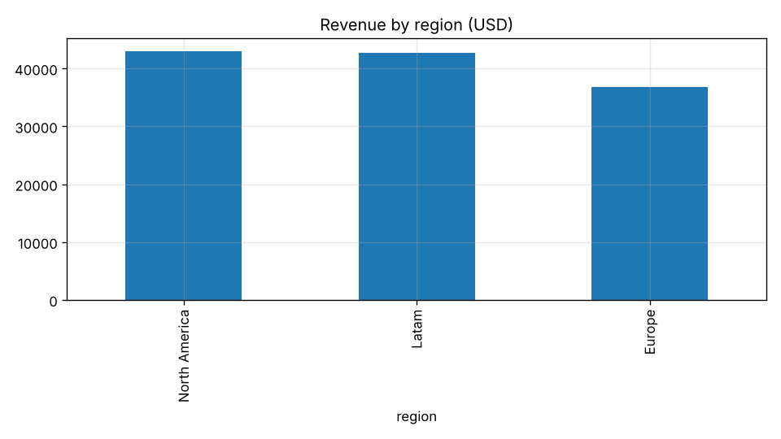
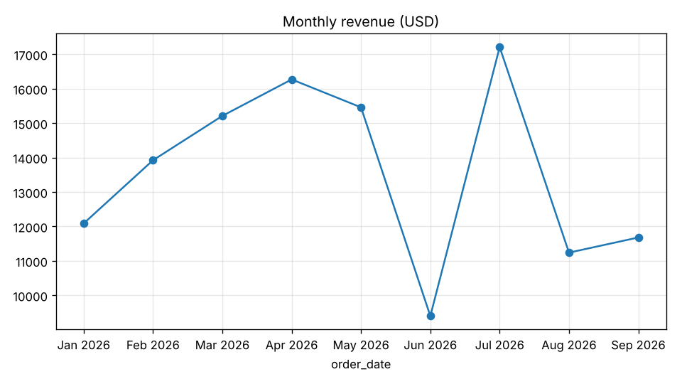

# Revenue by region and month - Jan to Sep 2026

_Source: `sample_sales.csv` · Generated 2026-10-27 by autonomous-data-analyst · Confidence: **medium**_

> **Question:** Which region drives our revenue, and how did revenue evolve during 2026?

## Answer
North America leads with $43,029 in revenue, essentially tied with Latam ($42,687, -0.8%); Europe trails at $36,756. Revenue peaked in July ($17,206) after a sharp dip in June ($9,399).

## Key findings
1. North America and Latam are within 1% of each other; Latam gets there with more orders (211 vs 194), so its average order is smaller.  
   Evidence: aggregate revenue_sum and order_id_count by region
2. Team Plan is the biggest revenue line in both Latam ($22,487) and North America ($22,288).  
   Evidence: aggregate revenue by region and product, top 5
3. Europe's top product is Pro Plan ($15,642), not Team Plan - a different buying pattern worth investigating.  
   Evidence: aggregate revenue by region and product, top 5
4. June revenue ($9,399) was 42% below May ($15,459) before rebounding to the yearly high in July ($17,206).  
   Evidence: time_series revenue by month

## Data quality
- 18 exact duplicate orders removed (would have inflated revenue by ~3%).
- Region had 9 spellings of 3 regions (case and stray spaces) - normalized.
- unit_price was text with '$' in 2/3 of rows - converted to numbers.
- order_date mixed ISO and dd/mm/yyyy formats - parsed both.
- 27 missing quantities filled with the median (3); 123 missing channels labeled 'unknown'.

Cleaning log (exact operations applied)

- `drop_duplicates(all columns): removed 18 rows`
- `normalize_text(region, title): 3 distinct values now`
- `to_number(unit_price): 0 values unparseable -> NaN`
- `to_date(order_date): 0 values unparseable -> NaT`
- `fill_missing(quantity, median=3.0): filled 27 values`
- `fill_missing(channel, value=unknown): filled 123 values`
- `derive revenue = quantity * unit_price`

## Caveats & next steps
- Median imputation of quantity is an assumption: confirm with the source system why 27 orders have no quantity.
- Check whether the June dip is real (seasonality, outage) or a data export gap.
